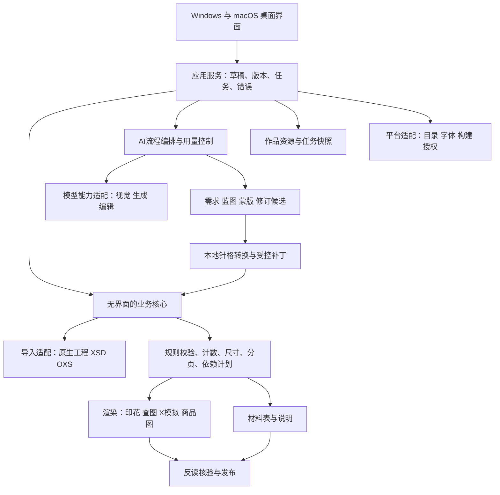

# 数据与系统架构

本文件给出与界面框架无关的逻辑设计。实体与字段是拟议契约，不是已实现的数据格式；具体schema在开发前结合样本冻结。

## 1 架构边界



核心不导入UI组件，不读取操作系统字体路径、窗口状态或隐含全局默认值。渲染和导出可以由客户端或无界面任务调用相同核心。原项目脚本作为重构依据，不作为安装后外部脚本依赖。

长任务运行在独立工作进程，便于处理内存回收、取消和崩溃；UI只传任务描述、路径与小型结果，不用大图字节占用进程消息。单机通过受控进程通道通信，不为本地操作默认开放HTTP监听端口。

AI外部请求由独立适配与编排层管理，不能混入确定性渲染器。当前聊天工具不作为运行依赖；候选供应商能力及成本策略见 [11](11-模型接入与质量评估.md)。

## 2 核心实体

| 实体 | 必要字段 | 不变约束 |
|---|---|---|
| Project | 项目ID、名称、客户、设计与SKU引用、格式版本、commit_seq | 每次提交递增序列；项目身份不等于货号或某次ZIP |
| SourceAsset | 原始格式、媒体类型、原字节SHA、相对位置、用途 | 原件不覆盖；缩略/转换图另存 |
| DesignRevision | 修订ID、父修订、W/H、palette、针法、空白、来源 | 冻结后不可原地改写 |
| ThreadCatalogRevision | 品牌、目录版本、原代码/名称/RGB、内容SHA | 同RGB不同代码仍保留 |
| SymbolLibraryRevision | 库ID/修订、图块、精确外部ID、ICC及像素SHA | 编辑产生新版本；库ID不当数组索引 |
| SymbolMappingRevision | 母版指纹、库修订、逐色绑定、显示序号、算法信息 | 有效色全部且唯一映射，无孤立/重复项 |
| SKURevision | 客户货号、设计修订、布料、格距、股数、留白 | 一个设计可关联多个SKU，不能覆盖旧规格 |
| ProfileRevision | 生产/查图/字体/语言/展示/材料规则 | 应用时取快照，不在任务中追随“最新” |
| LayoutPlan | 物理/像素尺寸、全局坐标、文字框、页窗口、预期产物 | 预览、正式输出和验收共享 |
| ExportJob | 精确引用、目标、版本、状态、阶段、产物指纹 | 输入一经排队冻结，重试不取当前草稿 |
| Artifact | 类型、文件名、大小、文件SHA、输入指纹、核验 | 产物种类和输入依赖可独立追溯 |
| ReviewRecord | 目标修订/产物SHA、检查类型、结果、证据、时间 | 旧认可不能自动套在新版本上 |
| DesignBriefRevision | 输入类型、题材/保留项、W/H/色数、目录、允许简化与预算策略 | 模型理解可修改；不把推断写成客户原始要求 |
| BlueprintRevision | 实际图像、输入SHA、提示模板、供应商/模型标识、采用状态 | 生成候选不覆盖已采用图；记录参数不保证再生同一图 |
| RegionAnnotation | 主体、负空间、保护/允许区域、原图/蓝图/网格变换 | 坐标语境明确，蒙版候选可人工修正 |
| ChangeProposal | 基准哈希、允许坐标、原值/新值、色板增量、范围核验 | 接受后新建母版修订；区域外语义和旧色板引用保持 |
| ConversionRun | 蓝图/规范输入SHA、蒙版修订、目录、参数、引擎指纹、输出母版SHA | 一次转换的完整依据；不隐式包含后续针格补丁 |
| AppliedPatch | 提议ID、父母版SHA、精确操作、结果SHA、接受记录 | 已应用补丁形成有序父子链；重新转换不能静默覆盖 |
| AIStageTask | 能力、配置引用、输入输出指纹、请求ID、用量、父子任务、状态 | 候选完成不等于母版审核；凭据不进入记录 |
| AIServiceProfile | 服务与能力、模型标识、端点/凭据引用、限制、超时策略 | 凭据放安全存储；项目只保存脱敏配置语境 |

本地作品列表是可重建的索引。设计、资源与任务记录存于项目实际文件中，不把用户数据唯一保存在应用内部数据库。

## 3 母版契约

R1 全针内容至少包含：

```text
schema_version
revision_id / parent_revision_id
grid.width / grid.height
palette[]: thread_key / brand / code(text) / name / rgb / catalog_revision
labels[height][width]: -1 或合法palette索引
stitch_types: 明确的全针声明及其他针法摘要
source_assets / import_report / revision_reason
origin_kind: imported / converted / patched
conversion_run_id 或 parent_revision_id + applied_patch_id
review_state / freeze_record_id
```

线色身份使用品牌+代码+目录语境；导入库之外的线号保留原值并标记未解析，不按颜色近似自动替换。若同一代码在不同目录RGB有差异，保留母版实际RGB与目录引用，不为同步目录改变历史设计。

索引矩阵需固定行列和坐标原点语义。导入/导出OXS或XSD时在边界适配，不让UI或各渲染器各自决定0基/1基。

转换母版引用完整ConversionRun，补丁母版引用父修订与AppliedPatch，导入母版保留原文件及解析器版本。每个已保存母版都保留实际矩阵，恢复旧作品不要求重新运行旧模型或转换器。补丁应用后，母版不能再标记为“仅从当前蓝图直接转换”；重新转换与补丁迁移规则见 [10 第7.5节](10-AI制版与修订.md#75-重新转换与已接受补丁)。

## 4 符号库与映射

内部 `symbol_key` 采用可携带、稳定字符串，另存 `external_id` 原类型及原文件名，例如 `int:24` 和 `str:0.1`。不能将原ID做浮点规范化而丢失精度或类型。

库包含原件和规范图块的关联、模式、像素尺寸、ICC内容指纹、黑色转换策略。规范图块产生新版本，原件不覆盖。映射引用确切库修订；不得从“用户现在选中的默认库”推断旧作品所需资源。

同一符号被多个DMC占用时事务失败；交换两项一次提交。删除使用中的符号只能在新库修订里进行，并要求为受影响项目另建映射，旧库仍能打开。

## 5 项目包与本地存储

拟议扩展名 `.stitchpress`，作为可携带容器；是否采用此扩展名在格式冻结时确认。它与“给工厂的成品ZIP”是两类不同产物。

```text
manifest.json                 格式版本、实体关系、内容SHA
designs/                      不可变母版修订
sources/                      采用原文件，保留原格式
resources/                    本项目所需符号、ICC、字体/背景引用或快照
configs/                      SKU、映射、预设与材料规则修订
reviews/                      人工与数字核验记录
jobs/                         可恢复的任务说明与产物记录
ai/                           设计要求、采用候选、必要蒙版、提议和脱敏调用记录
```

作品包默认包含足够继续工作的资源；体积较大的缓存、临时预览和所有历史导出文件不强制打包。导出可携带包前列出缺失资源、体积与随包资源范围。资源不能携带时明确列为外部依赖，未补全的包不标“可独立继续生产”。客户资源不自动变成面向所有用户发布的安装资源。

容器内部只用相对路径，保留原位置仅作为可选溯源文字，禁止安装后需要访问 `/Users/linglin/...` 或某个盘符。导入时检查路径逃逸、符号链接、重复/大小写冲突、超大解压量，避免覆盖项目外文件。

跨平台生成文件名时处理Windows保留名、非法字符、尾随点/空格、Unicode规范化和大小写碰撞；原始客户号不因此改写。清理后的名字冲突时加稳定区分标识，不覆盖另一款。

保存使用同卷临时文件/目录并原子替换；中断时保留上次完整项目。格式升级写新副本并记录迁移，不能先破坏旧包再尝试升级。新版本遇到未来格式时拒绝不完整写回，可以提供原文件取回。

### 5.1 单写入者与冲突处理

每个可写项目由应用服务中的一个提交协调器管理；UI、AI任务和导出工作进程均不直接替换项目包。工作进程写自己的隔离产物目录，向协调器提交带事件ID、任务ID、结果SHA和基准修订的事件。协调器依次校验、登记资源/记录，再原子提交项目，成功后才确认事件已保存。

- 草稿命令携带`expected_commit_seq`、读取依赖和拟修改实体的修订。全局序列变化仅触发重新校验；若读取依赖和拟修改实体均未变，协调器将命令应用到最新项目并自动提交。后台追加任务记录不应使无关标题编辑报冲突。若同一实体或读取依赖已变，拒绝冲突命令，保留用户未提交修改并显示差异；不以整个旧项目快照覆盖新项目。校验与写回在协调器内串行完成。
- 后台完成事件只追加所属任务结果。当前分支改变时，AI结果登记在原基准候选分支；导出结果仍关联原任务快照，不切换用户当前修订。
- 同一事件ID重复送达只登记一次。产物先写完整并核验、项目提交后才可清理暂存；中途崩溃时未登记产物隔离，已登记引用必须可读，不能形成悬空的成功记录。
- 同一项目被另一窗口/进程打开时，使用操作系统支持的排他写锁；第二个实例只读或另存独立副本。锁在整个读改写期间生效，崩溃残留标记不能仅凭时间戳强行抢占。网络共享盘、同步盘的并发写入不属于R1保证范围，可复制到本地受支持磁盘后编辑。

原子替换保证一次提交完整；排他锁和修订检查保证提交之间不互相覆盖。文件被外部改写时停止写回并提供另存副本，不能把外部修改当作可覆盖缓存。

## 6 参数覆盖与快照

默认合成顺序：应用通用默认 → 客户预设指定修订 → SKU修订 → 当前任务的显式覆盖。每次导出保存合成后的完整参数、来源和被覆盖字段，不只保存“与默认不同的几项”。

尺寸数值用十进制字符串＋单位＋来源保存。全局语言、当前窗口缩放、输出目录等偏好不应混入针格计算；输出目录变化不影响内容指纹，但文件名策略会影响包清单。

## 7 依赖与失效

| 变更 | 需重算/重做 | 可保持 |
|---|---|---|
| 母版针格/线色 | 针数、映射一致性、全部图纸/材料/模拟/规格图 | 无关客户资源 |
| 符号映射/库像素 | 含符号的生产、查图、图例、材料符号列、印花商品图 | 仅线色针格的X模拟和纯针数值，若依赖未变 |
| 实际格距/留白 | 生产、原倍率分页、规格、材料规则适用性、说明 | 针数及不带规格的设计X图块 |
| 输出DPI/生产ICC/黑色策略 | 对应渲染、色彩核验、嵌入这些像素的PDF/图片 | 母版、针数 |
| 源图ICC解释/工作色彩转换/alpha处理 | 新规范输入、转换候选及其下游检查；采用新母版后更新相关产物 | 原源文件、历史冻结母版及旧交付；不自动采用新候选 |
| 查图纸张/字号/重叠 | 查图布局、分页、PDF、页范围说明 | 已通过的生产TIFF |
| 材料规则 | 材料表、材料相关说明 | 已通过的图纸、母版 |
| 场景/商品文字 | 选中商品图及其核验 | 生产/查图/Excel |
| 仅模拟图样式 | 对应模拟图和引用它的商品图/说明 | 图纸、材料表 |
| 仅交付/试印状态 | 状态与报告记录 | 全部生产产物 |
| 新蓝图/新AI候选 | 当前制版分支的后续转换与检查 | 已冻结母版及其旧交付，直到明确采用新修订 |
| AI服务/提示模板变更 | 后续新调用及评估 | 已保存候选、冻结母版和不需新调用的本地导出 |

最终包清单和双语说明按实际变更更新。表中“可保持”不意味着跳过指纹检查；引用过期产物时必须有全部依赖相同的证据。

## 8 任务状态与发布

```text
queued → validating → planning → rendering → verifying → publishing → completed
任一运行阶段 → cancelling → cancelled
任一运行阶段 → failed
```

检查点按产物保存，不把半写文件当作完成。任务进入发布前所有必需目标都通过检查；先写暂存目录，核验完成再移动为新的正式版本。发生文件系统边界差异时在目标卷暂存，不依赖跨卷rename原子性。

`completed`只表示所选目标已写出并通过所需数字核验；人工外观尚未检查时继续标记`visual_review=pending`。它不能自动变成“已交付”或“工厂通过”，相关记录另行维护。包内有文件不代表它已被人工认可。

重试验证原输入资源、已完成产物和引擎/布局版本后复用；任一变化就失效相关部分。关闭UI时提醒正在运行的工作，允许安全停止或等待，不把关闭窗口等同于立即杀死写文件。

建议任务指纹至少包含：母版、映射、资源、有效配置、布局计划、渲染器版本、目标种类。预览缓存还需分辨率、视口和检查叠层；不能用货号作为唯一缓存键。

AI制版阶段另建可恢复状态：需求→分析→蓝图候选→待采用→本地转换→审查/修订→待冻结→已冻结。网络失败、取消、预算耗尽和供应商结果未知独立记录；输入变了之后旧响应不能自动落在新分支。应用暂停不能假定供应商已停止计费。

AI用量记录与本地ExportJob分开，避免重试本地渲染触发重复模型调用。模型只可通过受限应用操作提出参数/修订候选，不能接收任意文件系统或shell执行权。精确局部补丁由本地范围验证、差异审查和事务提交控制。

AI任务另存发起安装实例ID、服务账户语境（脱敏）、原任务/请求ID及执行归属。复制或跨端导入工程只恢复任务记录和已落盘结果；未完成远端任务显示“来自另一设备”，不因打开工程而自动重试、轮询或接管。仅原发起实例默认具备继续调度资格；另存副本也不复制运行资格。用户在另一设备明确选择重新提交时创建新任务，关联原任务，提示原请求可能仍运行/计费，不能声称原请求已撤销。R1不实现跨设备自动调度或全局锁。

已知花费和未知/在途预留随工程保留，复制不能重置预算；重复导入同一任务按ID去重。BYOK预算仅保证当前实例调度，多个副本或其他客户端共同使用账户的总支出不由本地APP保证；托管方式若提供账户总额度，应由服务端账本控制。远端状态查询需要匹配服务账户及能力，凭据不随工程复制。

## 9 核验记录与授权

分别保存 `numeric_review`、`visual_review`、`customer_appearance`、`delivery_status`、`factory_print_test` 和 `wash_test`；不合成一个含糊的“通过”。审查对象指向修订和产物内容，而非可被覆盖的文件名。

离线授权由应用服务控制允许的导出目标，核心仍校验任务资格。授权文件和签名密钥不进入作品包；发行私钥不进入客户端。过期不会损坏或扣留客户自有设计、设置及已生成文件。续期、换机、设备信息范围和导出中途到期行为见 [09](09-阶段计划与待定事项.md)，需在发布前明确。

## 10 双端可复现边界

W/H、线色身份、逐色针数、格距、分页窗口和取整规则在双端必须相同。字体文件、ICC、图块和渲染规则绑定内容版本。ZIP时间戳、文件元数据和某些编码器输出可能不同，使用逻辑指纹及解码像素核验，不能只比较整个ZIP的SHA判断业务是否相同。

对要求确定性的符号内区建立精确像素样本；文本换行、边界和字号单独检查。跨平台字体栅格差异不能成为遮挡、缩水或裁字的免责理由。

## 10 当前本地格式实现（2026-11-11）

0.1.0.dev2采用`.stitchpress` ZIP容器schema 2：`manifest.json`中保存`project_id/commit_seq/entities/events/assets`，资源以相对路径及SHA登记；概念实体在`entities`具名对象中，不要求使用前文拟议的每实体目录。内层全针Design仍使用schema 1。当前限制256MiB容器/解压总量、2048成员，并拒绝未登记文件、未知清单字段、路径逃逸、链接及跨端名称冲突。

旧容器schema 1只读原件，另存为schema 2并保留迁移记录/原资源；未来版本拒绝写回。冻结新增源图、Brief、蒙版与源ICC指纹；旧审核未绑定来源时必须复核才可正式生产。实际代码契约及操作见[15](15-R1本地接续与验收.md)，这只冻结当前本地实现范围，不关闭E08双端/真实服务退出门槛。
