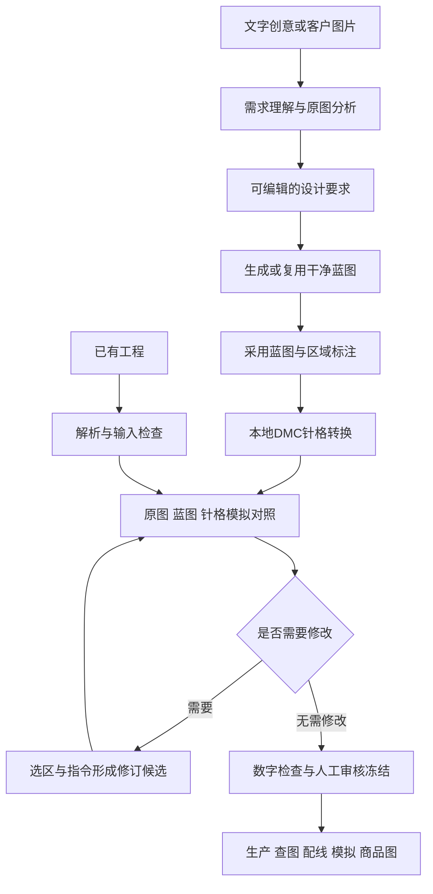

# AI制版与修订

> 当前范围v0.5：本文件为二期AI设计；其真实模型、评估集、预算与冻结门槛不阻塞一期参考功能。已有实现保留，完整AI能力仍未验收。

2026-11-11 v0.3。用户已明确希望将AI集成进StitchPress，使产品覆盖参考后期APP之外的创作、来图制版与修改。A01–A12按用户2026-11-11最新决定归二期；一期先复刻参考后期功能。本次补齐输入规范化、转换溯源和补丁迁移契约；供应商、型号和收费尚未选择，也未执行实际模型调用。

## 1 三种入口与共同终点

2026-11-12商品增强补充：AI设计电商模板、场景生图/背景编辑及文案归二期A11增强，详见[22](22-电商多模板与AI增强.md)。模板候选与素材候选独立保存，采用后可离线复用；商品布局不进入针格母版修改链，尺寸/针数等使用本地字段。第一期先完成多套本地模板选择与配置，不等待模型服务。

| 入口 | 首先处理什么 | 何时进入生产交付 |
|---|---|---|
| 已有可信工程 | 解析、检查、规格和符号绑定；AI可按需解释或辅助检查 | 支持针法、数据完整且当前母版审核通过 |
| 客户来图 | 识别图片类型、提取要求、复用或重建干净蓝图 | 蓝图经转换、局部检查和审核，形成冻结母版后 |
| 文字创意 | 明确主题、关键物体、构图与尺寸约束，生成原创平面蓝图 | 与来图路径共用制版和审核，不直接把生成图交给工厂 |

“自动运行”与“自动认可”分开。应用可连续执行已选阶段，默认在采用蓝图、冻结母版两个内容检查点停留；用户不必为每次本地统计或渲染重复确认。批量模式可保存已采用的规格与阶段策略，但不能跳过不支持针法、超色、缺资源等硬性错误。

## 2 AI和本地核心的职责

| 工作 | AI可以做 | 权威结果由谁决定 |
|---|---|---|
| 理解题材与保留项 | 描述对象、风格、遮挡、关键细节和疑点 | 用户可编辑的结构化设计要求 |
| 平面蓝图 | 新创作、移除针脚布纹、按指令生成局部候选 | 用户采用的实际图像文件及SHA |
| 主体/背景判断 | 提供区域、解释与不确定性 | 可修正蒙版及用户审查，不能仅信模型置信度 |
| 针格/线色 | 建议针格大小、细节取舍、候选色数 | 本地转换器生成的矩阵、目录身份与检查结果 |
| 改图 | 解释选区、提议操作或蓝图局部编辑 | 精确补丁、范围检查、差异预览及新母版修订 |
| 质量检查 | 指出轮廓、姿态、遗漏和语义疑点 | 独立数字检查＋人工外观记录 |
| 交付 | 提供文案草稿、解释结果 | 本地渲染和核验的TIFF/PDF/XLSX等 |

模型不能靠看截图统计最终针数、猜DMC身份、给图上直接画色号就当工程，也不能以“审核通过”的文本写入最终生产状态。

## 3 设计要求

每次制版先建立DesignBrief，至少包括：

- 输入类型与原文件、客户号、来源关系；“临摹重建”和“原创”明确区分。
- 题材、主要对象、相对位置、必须保留的特征与允许简化的细节。
- 目标W/H或明确的候选范围、是否满绣、背景与主体白色处理方式。
- 线色目录版本、实际色数上限、符号库容量、是否允许特殊针法；R2生产只接受全针。
- 产品预设、实际格距、预期物理尺寸；缺值引用明确预设或标未确认，不编造客户要求。
- 受保护区域、局部修订范围、蓝图候选数量、最大迭代次数及费用设置。

例如“160×160格、最多32色”只有在客户选择这一规格后才生效，不从某个历史订单继承为所有来图默认。色数是上限，不要求凑满；改变W/H、目录或允许的简化程度是明确的方案变更。

用户输入和模型理解并列展示。自然语言出现“更细腻”而针格限制不变时，给出可检查的局部方案或说明细节冲突，不擅自把160格变成240格。

## 4 原图分析和蓝图

### 4.1 输入判断

识别是否存在布纹、X针高光、拍摄透视、投影、边框、文字遮挡和裁切，给出复用/重建建议。干净平面图可以直接采用；已有冻结工程优先复用，不为使用AI重复画图。

多模态分析保存关键对象清单与重点检查区域，如脸、手、耳朵、细杆、花瓣数量、果肉切面、主体浅色和真正负空间。模型给出的边界只是候选，不能当像素级真值；需要坐标转换和可视化确认。

### 4.2 生成规则

原创蓝图默认只用文字与结构化要求；来图转换或定向返修使用明确的一张目标图及必要蒙版，不把聊天截图或不相关作品混作参考。默认先生成一张候选，用户可在额度内增加分支，不默认并发生成大量近似图。

蓝图移除布纹、针脚、材质反光和摄影投影，保留主要轮廓、对象关系与关键特征；不承诺逐像素恢复原供应商母版。主体浅色仍不透明，真实负空间另行标注，透明像素不自动等同于所有白色区域。

蓝图是工程输入，可按目标构图保留原比例，不强制为营销3:4去拉伸或裁主体。展示图的3:4通过其独立画幅规则处理。

### 4.3 候选采用

保存生成原文件、输入SHA、设计要求版本、提示模板版本、供应商/模型标识、请求标识和实际输出属性。平台可能改变模型实现，记录提示词或seed不等于可重现同一图；采用后的实际文件才是可恢复依据。

界面比较原图、候选与关键局部；保留采用和已展示版本。明显失败且未采用的临时结果可按项目清理策略删除，但不能丢失后续母版依赖的输入。

## 5 蓝图到可绣母版

本地转换器接收已采用蓝图、W/H、线色目录、颜色上限、主体与负空间蒙版、细节保护区及算法版本，生成：

- 规范化输入与坐标变换，保留裁切/缩放依据。
- 合法的针格矩阵、逐格线色与明确的空白。
- 实际色数和逐色针数、低频色/分散针/密集区的疑点列表。
- 参数、输入指纹、确定性转换结果和母版X针格模拟。

量化和色数限制按可复算算法执行。AI可以建议参数，但不能直接返回一大段labels并跳过转换校验。不能全局模糊、无差别删1–9针颜色或填全部孔洞来换取“整洁”。少量针可能是眼睛、高光、细轮廓；先显示贡献与位置，再决定是否合并。

同一采用蓝图、参数与转换器版本必须得到同样的矩阵、线色及计数。转换后的母版RGB保留其目录来源，不根据印花符号颜色反推线色。

### 5.1 输入色彩与透明度契约

先保留原字节，再生成独立规范输入；处理顺序为方向归正、颜色转换、透明度/区域处理、裁切缩放、网格采样与目录量化。方向归正同步变换蒙版和坐标，不能只旋转显示图。

| 输入 | 本地处理 |
|---|---|
| 有效嵌入ICC的图像 | 根据源ICC转换到绑定版本的sRGB工作空间；R2基线采用相对色度意图，相关选项显式保存 |
| 无ICC的RGB/灰度图 | 明确提示按sRGB解释，保存`assumed_srgb`来源标记；用户可指定正确源配置并生成新规范输入 |
| 无ICC的CMYK或损坏/不匹配ICC | 阻止转换，要求指定有效源配置或换源；不借用生产ICC猜测源配置 |
| 全透明像素 | 不读取隐藏RGB参与选色；若与主体必绣蒙版冲突，阻止转换并定位，要求修正输入或标注 |
| 半透明像素 | 按显式alpha阈值/网格覆盖规则形成待确认边缘；在明确背景色上合成可见颜色后量化，不自动判为无针或先铺白底 |

负空间和主体标注冲突必须解决；已确认负空间为无针，主体白色按所选线色正常计针。不透明区域里的白色不能仅凭颜色被当作背景。alpha阈值、覆盖率、采样与合成背景都是转换参数；E0用浅色边缘样本确定基线并冻结，未明确参数时不运行正式转换。颜色通道与alpha分别保留，避免转为RGB时意外丢失透明语义。

目录数字RGB的工作空间需声明；当前无ICC数字RGB按sRGB解释并记录来源，不作实物色样承诺。色距、候选选择、并列决胜、采样/抖动策略与随机种子（若使用）必须在转换算法版本中固定，不能依赖第三方库默认值。

ConversionRun保存源与规范输入SHA、源/目标ICC指纹或假设、意图、方向和坐标变换、alpha/蒙版策略、目录修订、量化参数、依赖构建指纹及输出母版SHA。规范输入、蒙版和实际矩阵随工程留存。双端使用同一受支持引擎构建验证固定样本矩阵一致，颜色归一化不是只给文件追加sRGB标签。

## 6 浅色、负空间与细节

AI和图像算法可给出主体表面、真实背景、待判定区域三个候选层；用户可以画选区或修正蒙版。蒙版保存原图/蓝图/网格间坐标映射，避免裁切后落错位置。

白蝶翼、白花瓣等对象表面要有针；枝叶间空隙即使封闭也保留不绣。当前厂家预设的DMC3865只作用其明确范围，不替换其他目录的所有白色。

检查视图可用对比底色和高亮显示“未绣格”与“白色绣线”，正式模拟仍按所选背景规则输出。已确认负空间作为保护区，自动候选不得跨越；需要改变时另开明确的修订范围。

## 7 局部指令修订

二期AI交付支持两种修订：蓝图局部编辑后重新转换选区，以及对母版提出受限针格操作候选。通用自由绘画不是前置条件，但用户必须能够修正AI在局部判断上的错误。

### 7.1 请求内容

包含基准母版/蓝图修订、明确选区、允许的修改类型、保留项、色数/目录限制及原因。例如“只调整这片叶子的层次，不改轮廓与右侧花朵”，不能仅靠文字中的“左边”直接决定精确可写区域。

### 7.2 受控补丁

本地补丁记录每个坐标的原线色/空白与新值、允许范围、保护范围、增减针数及新增线色。落地前验证基准哈希仍一致、原值匹配、索引合法、库容量足够。

区域外的格点、DMC代码、RGB、空白与已有色板语义保持。若新颜色需要加入色板，追加新项，不修改区域外正在引用的旧色板项。若用户要求全局换线色，就作为明确的全局修订，不能伪装成局部编辑。

### 7.3 不依赖模型保证范围

图像模型的编辑蒙版可能只是引导，无法保证区域外完全不变。应用保存原蓝图，并在对齐有效时只取允许区域的候选像素；区域外由本地合成保留原像素。若输出发生构图移动、比例变化或无法可靠对应，不能强行贴回后宣称局部通过，应显示为新的整体候选或要求重试。

即使蓝图外区被保留，整幅重新量化也可能改变区域外针格。因此严格局部模式只允许重算授权网格区域，复用外部矩阵与色板；最终逐格差异检查在应用补丁前后都验证。AI的“只改这里”说明不作为证据。

### 7.4 接受与撤销

展示原图/前后蓝图/前后针格及变化热区，列出新增或删除针数、线色变化、符号容量与受影响文件。接受后另存新母版修订，旧版可恢复；拒绝不修改当前采用版本。冻结或已交付母版绝不原地覆盖。

### 7.5 重新转换与已接受补丁

蓝图、转换母版与补丁母版分别保存。每个补丁保存基准/结果SHA、坐标原值/新值和接受记录；母版来源可追溯到一次完整转换及有序补丁链，不用“当前蓝图”覆盖历史关系。

改变蓝图、蒙版、W/H、目录或减色参数后，整图重新转换产生独立候选，保留原补丁母版和原冻结记录。界面列出已有人工/AI修订及其在新候选中的差异；不自动选择新结果，不把旧审核套到新候选。

只有相同网格坐标与目录语义可对应时才允许尝试迁移补丁，逐项检查原值、允许/保护区和色数容量；旧色板索引不能直接套到新色板。原值不符、坐标变换不明确或线色身份冲突的操作标为冲突，由用户重新修订或明确放弃。迁移成功也形成新的ChangeProposal，经接受和复核后再冻结。W/H改变时R2不自动缩放补丁坐标。

例如先修正两针眼睛，再将32色改成28色：应用保留32色补丁母版，同时展示28色新候选及眼睛差异；只有审核迁移结果后才采用。用户撤销可恢复原修订，不依赖重新生成蓝图。

## 8 质量与冻结

三类结果分别展示：

1. 本地硬检查：W/H、合法索引、针法支持、色数、逐色针数、空白、资源与符号映射。
2. AI视觉疑点：对象遗漏、姿态或身份变化、主体浅色、细节变形和过度简化，附输入来源与区域。
3. 用户外观记录：整体及至少两处关键局部、必要的负空间检查，接受的简化与已知限制。

模型看不清或无法判断时标待复核，不输出伪确定分数。视觉模型不能证明不存在遗漏；冻结必须满足数字检查并由用户完成内容审查。评分用于排序疑点，不是自动量产通行证。

冻结后进入现有印花生产核心：绑定母版/符号库/预设哈希，生成TIFF、PDF、XLSX、白底X模拟和双语说明。生成后的模拟来自矩阵，不能再用图像模型“美化”而掩盖真实针格。厂家的设备套准与洗水仍需实测。

## 9 用户工作区

增加“AI制版”主入口：左侧阶段和版本，中央原图/蓝图/针格对照，右侧设计要求、局部指令和检查项；底部显示本阶段用量、迭代次数和继续操作。

模型对话是作品上下文的辅助入口，不是唯一操作方式。用户能看见正在用哪一版输入、选择哪个区域、结果在哪里、为何停止；对话中的旧图片不能悄悄替代当前采用文件。

自然语言修改规格时先形成字段差异；常用操作如改标题可直接本地执行，涉及针格/线色的修改走可审阅候选流程。模型不能调用任意shell、删除历史版本、修改未授权项目或自动把产物发给客户。

## 10 商品素材

AI可帮助生成纯背景、文案草稿、场景建议；已冻结设计的实际主体默认由本地X模拟或选定原图确定性贴入。不能把“根据这幅图生成一张更漂亮挂画”当成精确的厂家包装模拟。

规格、货号、尺寸、色数与材料来自SKU；AI只改表达，不改事实。洗护声明需要材料依据，不由模型随意补充“绝不褪色”等承诺。AI背景与当前母版主体分层留存，方便换背景不重做生产图。

## 11 R2完成条件

至少一个真实模型服务组合在Windows/macOS完成：客户来图→采用蓝图→固定针格/目录转换→受控局部修订→审核冻结→完整厂家包；文字创作使用相同下游链路。

必须有成功样本、需要人工修正的样本和明确拒绝/中止样本，并覆盖费用上限、网络失败、候选漂移、主体白色和区域外不变。不能用聊天演示截图或“接口已经接通”代替端到端能力验收。
